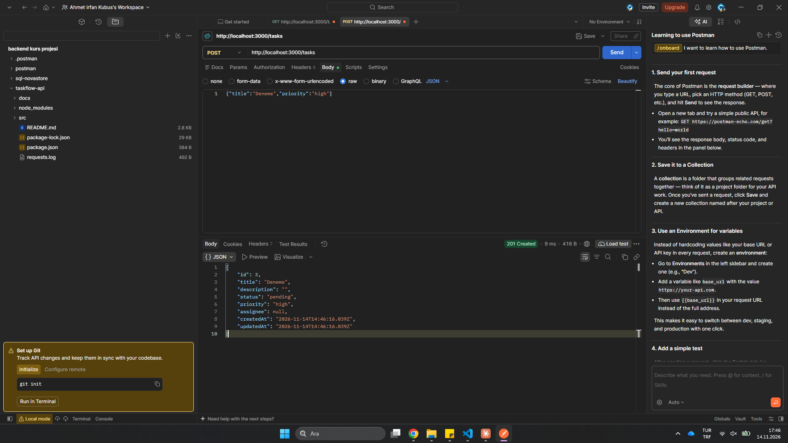
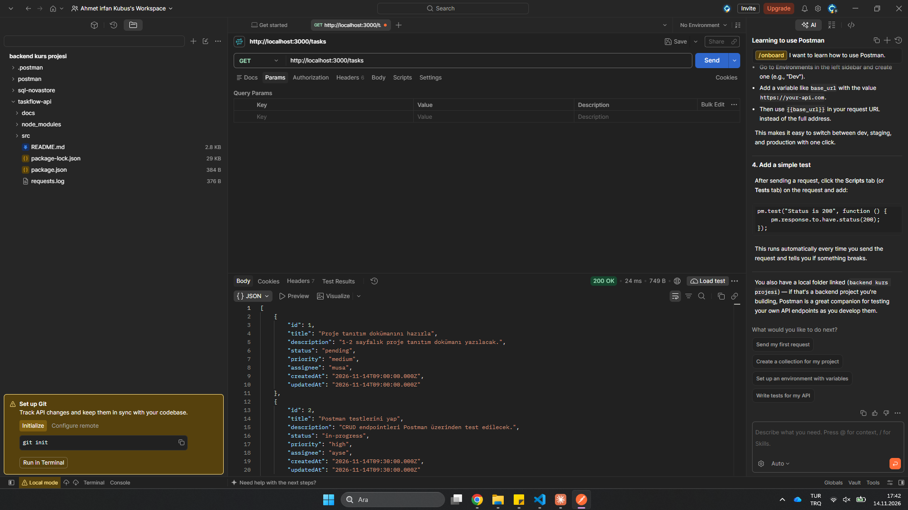
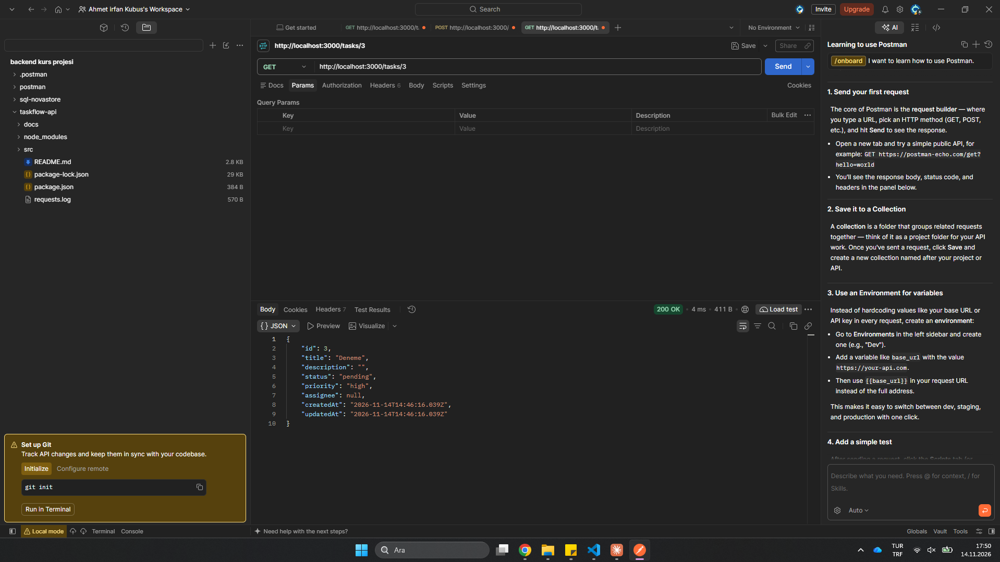
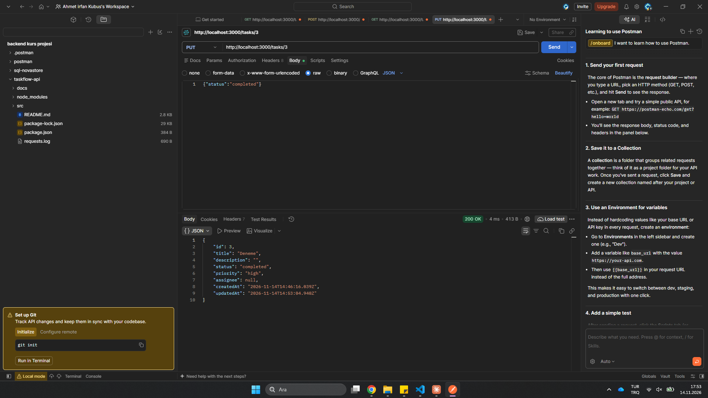
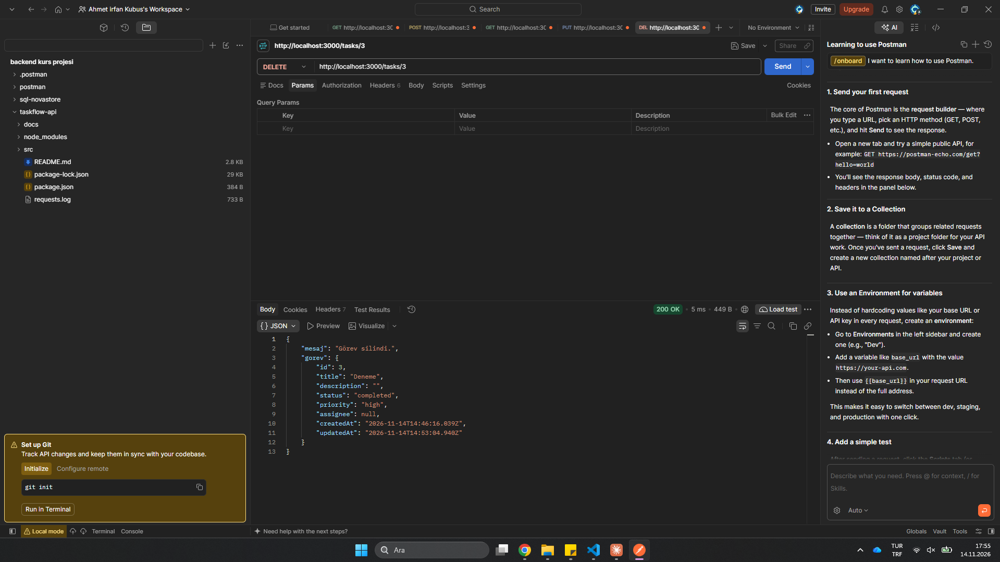

# TaskFlow – Görev ve Proje Yönetim Sistemi API

Node.js ve Express ile geliştirilmiş, görevlerin oluşturulması, listelenmesi, güncellenmesi ve silinmesini sağlayan bir REST API'dir. Veriler `src/data/tasks.json` dosyasında saklanır.

## Gereksinimler

- [Node.js](https://nodejs.org) 18 veya üzeri
- Git
- (Test için) Postman

## Kurulum ve Çalıştırma

```bash
# 1. Projeyi indirin
git clone https://github.com/irfankubus/taskflow-api.git
cd taskflow-api

# 2. Bağımlılıkları kurun
npm install

# 3. Sunucuyu başlatın
npm start
```

Sunucu varsayılan olarak `http://localhost:3000` adresinde çalışır. Farklı port için `PORT` ortam değişkenini kullanabilirsiniz.

> **Windows PowerShell notu:** "running scripts is disabled on this system" hatası alırsanız `npm start` yerine `npm.cmd start` komutunu kullanın.

Sunucu çalıştığında tarayıcıdan `http://localhost:3000/tasks` adresini açarak görevleri JSON olarak görebilirsiniz.

## Proje Yapısı

```
taskflow-api/
├── package.json
├── README.md
├── docs/
│   ├── PROJE_TANITIM.md
│   └── screenshots/        (Postman ekran görüntüleri)
└── src/
    ├── app.js              (sunucu ve middleware kurulumu)
    ├── routes/taskRoutes.js
    ├── controllers/taskController.js
    ├── middleware/logger.js
    └── data/tasks.json
```

## Görev Modeli

| Alan | Tür | Açıklama |
|---|---|---|
| id | number | Otomatik atanır |
| title | string | **Zorunlu** |
| description | string | İsteğe bağlı |
| status | string | `pending` (varsayılan), `in-progress`, `completed` |
| priority | string | `low`, `medium` (varsayılan), `high` |
| assignee | string | Göreve atanan kişi |
| createdAt / updatedAt | ISO tarih | Otomatik atanır |

## Endpoint Listesi

| Method | Endpoint | Açıklama | Başarılı kod |
|---|---|---|---|
| GET | `/tasks` | Tüm görevleri listeler | 200 |
| GET | `/tasks/:id` | Tek görevin detayını getirir | 200 |
| POST | `/tasks` | Yeni görev ekler | 201 |
| PUT | `/tasks/:id` | Görevi günceller | 200 |
| DELETE | `/tasks/:id` | Görevi siler | 200 |

Hata durumları: `400` (eksik/geçersiz veri), `404` (görev veya endpoint bulunamadı).

### Örnek İstek – Görev Ekleme

```http
POST /tasks
Content-Type: application/json

{
  "title": "API dokümantasyonu yaz",
  "description": "Endpoint açıklamaları hazırlanacak",
  "priority": "high",
  "assignee": "musa"
}
```

Yanıt (201):

```json
{
  "id": 3,
  "title": "API dokümantasyonu yaz",
  "description": "Endpoint açıklamaları hazırlanacak",
  "status": "pending",
  "priority": "high",
  "assignee": "musa",
  "createdAt": "2026-11-14T12:00:00.000Z",
  "updatedAt": "2026-11-14T12:00:00.000Z"
}
```

### Örnek İstek – Güncelleme

```http
PUT /tasks/3
Content-Type: application/json

{ "status": "completed" }
```

## Logger Middleware

Her isteğin method, endpoint ve zaman damgası konsola ve proje kökündeki `requests.log` dosyasına yazılır:

```
[2026-11-14T12:58:54.662Z] PUT /tasks/3
```

## Postman ile Test

Postman ekran görüntüleri `docs/screenshots/` klasöründedir.

### 1. Görev Ekleme – `POST /tasks` (201 Created)


### 2. Görev Listeleme – `GET /tasks` (200 OK)


### 3. Görev Detayı – `GET /tasks/3` (200 OK)


### 4. Görev Güncelleme – `PUT /tasks/3` (200 OK)


### 5. Görev Silme – `DELETE /tasks/3` (200 OK)

